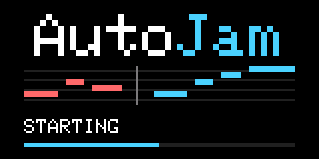

# AutoJam

弹一句，让掌上的小乐队接下去。AutoJam 是为 **Fingersonic Guitar（ESP32-S3）** 开发的独立即兴演奏固件。装好后，设备自己演奏主旋律、和声、贝斯和鼓；演奏时无需连接电脑或 Wi-Fi。

**第一次玩？** 短按摇杆让乐队开始，长按旋钮录入自己的「长——短、短」，再短按旋钮，听下一句怎么接。[零基础图文入门](docs/QUICKSTART.zh-CN.md) · [14 秒动机接句试听](docs/audio/first-motif.mp3) · [固件下载](https://github.com/nasonliu/AutoJam/releases/latest)

## 两种玩法

| | 你做什么 | 设备做什么 |
|---|---|---|
| **AUTO** | 短按摇杆播放。想教它一句时，长按旋钮并弹琴弦 | 自动走和弦进行；先回应你的节奏和旋律走向，之后按曲风接句 |
| **LOOP** | 拨摇杆选和弦，直接弹一小节或敲鼓点 | 记录输入，用新音高、长短和停顿作答；按住琴弦可以跨小节延音 |

可以选 12 个主音、随风格或手选调式、两组常用和弦进行。八方向和弦图会随调性变化。轨道页分别显示大鼓、军鼓、镲、贝斯、和声和主旋律。

14 种风格包括 Lo-fi、Swing、Ambient、Bluegrass、Bossa Nova、8-bit、Synthwave、R&B、Rock、Pop、中式五声、都节、Americana 和 Blues。主旋律的音色和响度可单独调整。

## 安装、开发与许可

- **已装 AutoJam**：[开始演奏与录动机](docs/QUICKSTART.zh-CN.md)。
- **第一次装机**：[下载 App0、安装与恢复](docs/FIRMWARE.zh-CN.md#安装到设备)。
- **开发者**：[编译、工程结构与测试](docs/FIRMWARE.zh-CN.md#从源码编译)。固件入口为 [AutoJam.ino](AutoJam.ino)，音乐引擎为 [Jam.cpp](Jam.cpp)。
- AutoJam 基于 Fingersonic 开发套件中的 FM Studio 示例，采用 Apache-2.0，随附的 DaisySP 子集采用 MIT。原作者和第三方许可见 [NOTICE](NOTICE.md)、[LICENSE](LICENSE) 和 [THIRD_PARTY](THIRD_PARTY.md)。
