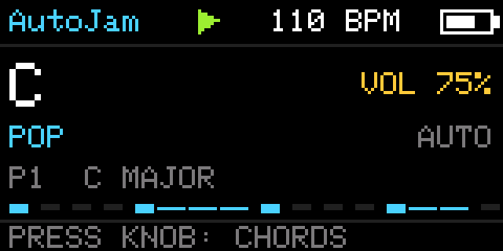
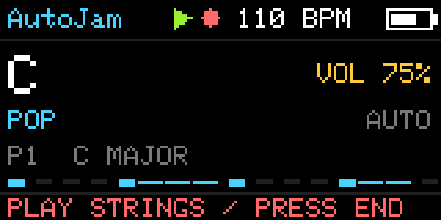
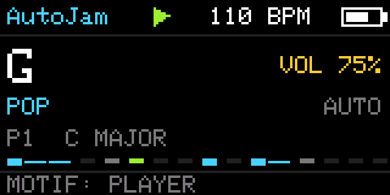
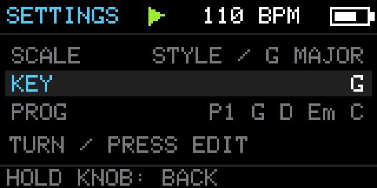
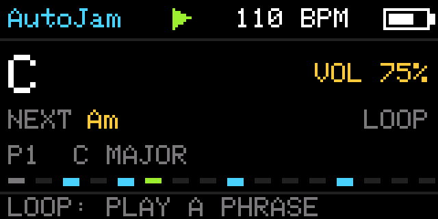
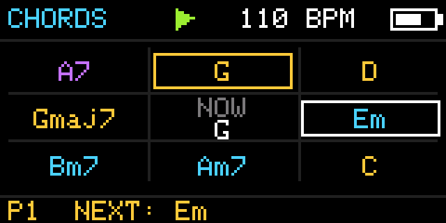
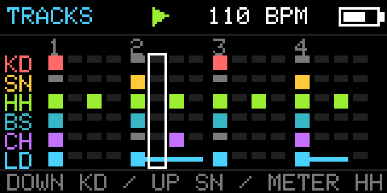

# 第一次玩 AutoJam：教机器唱你的一句话

第一轮只用 **摇杆、可按下的旋钮、六根触摸弦**。摇杆管播放，旋钮管音量和录入，琴弦用来告诉机器你想唱什么。还没安装的设备，先看[固件安装](FIRMWARE.zh-CN.md#安装到设备)。

## 1. 按一下，让乐队开始

开机看见 AutoJam 字样后，等演奏主页出现。看屏幕右侧的 **AUTO**，然后把**摇杆垂直按一下就松开**。顶部出现绿色三角，鼓和贝斯开始走。**直接转旋钮**可以调大或调小，右上黄色的 VOL 会跟着变。再按一下摇杆就停止。

图里是 Pop，开机看到其他风格也能直接玩。如果右边写着 LOOP，按下文「换一种风格」的办法进入 SETTINGS，把 MODE 选为 AUTO。

## 2. 录动机：把「哒——，哒、哒」交给它

**动机就是一小句你能哼出来的声音。** 先保持播放，跟着鼓点试一次：

1. 在演奏主页**长按旋钮约 1 秒**，看到顶部红点和底部 **PLAY STRINGS / PRESS END** 就松手。鼓和贝斯会继续，主旋律给你让出位置。
2. 随便挑一根弦，**按住一个鼓点，再松手**。稍等一下，换旁边的两根弦，各轻点一下。嘴里可以一起念「哒——，哒、哒」。琴弦会按当前和弦发声，记不住音名也没关系。
3. **短按一次旋钮**结束录入。先别停播放，手离开琴弦，听下一小节。先找那个长音后的空隙，再听后面两个短音如何随和弦变化。
4. 让它多演几句。想换题目，就再长按旋钮，录一句「短、短、长——」。这次听机器把长音放到了哪里。

[听一遍示范：前 2 秒是输入，之后是机器的回答](audio/first-motif.mp3)。这是固件引擎的主旋律独奏，方便对照音长和停顿；上机时还会听到伴奏。

**什么时候开始计时？** 第一次触弦就是这句的起点。按下和松开都会对齐到最近的十六分音符。录入窗口为两小节、最多八个起音，同一格取第一个音。第一次用三个音就够了。录好的动机保存在本次通电的内存中。

## 3. 同一句话，换一种风格

从主页**短按旋钮三次**，依次经过 CHORDS、TRACKS，来到 SETTINGS。转到 **STYLE** → 短按进入 → 旋转选择 → 短按完成。长按旋钮约 1 秒回演奏主页。播放中改风格会排队，可以继续听到下一段。

先试 **8-BIT** 和 **R&B**：前者把短音分开，有空间时跳八度呼应；后者会留出气口，在尾音前用轻短的音带进去。可以保持同一个动机，前后比较。想让旋律更突出，在同一菜单找到 **LD LVL** 调高；整台机器的音量仍在主页转旋钮控制。

## 4. 想自己换和弦时，再玩 Loop

在 SETTINGS 中把 **MODE** 改为 **LOOP**。回主页开始播放，先听到鼓。把摇杆向一个方向轻拨再回中，和弦会在小节线上切换。此时**直接按弦再松开**就能录进这一小节。下一句交给机器；第四拍按住跨过小节线时，设备会继续听第二小节。

在演奏页，**Down 或 Tempo** 敲大鼓，**Up** 敲军鼓，**Meter** 敲镲。选好和弦后，只敲一个「咚、咚咚」，也能让下一句旋律用不同的音高回答这个节奏。

## 卡住时看这里

| 遇到的情况 | 怎么办 |
|---|---|
| 一转旋钮就在换选项 | 长按旋钮回演奏主页，看到 VOL 后再转 |
| 按完三个音，机器还在等 | 红点亮着表示还在录。短按旋钮结束，保持播放到下一小节 |
| 只听到鼓点 | 看右侧是否为 LOOP。拨一下摇杆选和弦再弹；想让乐队自己开始，切回 AUTO |
| 屏幕上的 C、Am、P1 看不懂 | 第一轮可以跳过这些字，只看绿色播放三角、红色录入点和底部提示 |

本文截图由固件自身的显示代码在电脑上渲染，按整数倍放大了设备的 160 × 80 像素画面。
